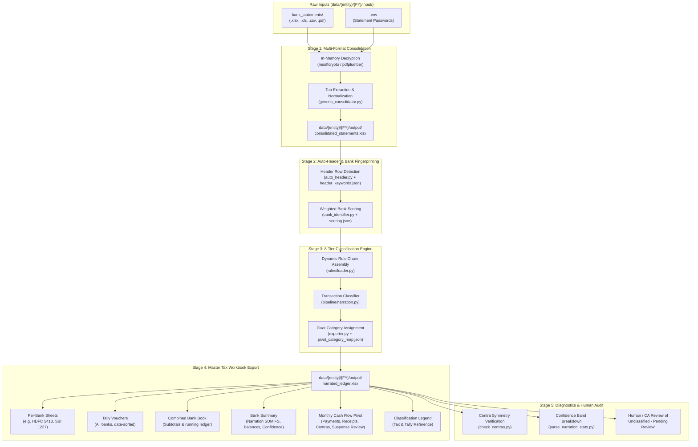
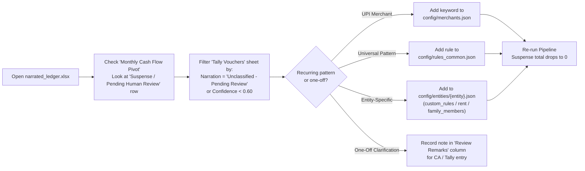

# Tax Automation System

**100% Config-Driven Financial Statement Consolidation, 8-Tier Transaction Classification, and Indian Taxation & Tally Ledger Engine.**

---

## Product Overview

The **Tax Automation System** is an end-to-end accounting and Indian tax-preparation platform designed for taxpayers, family offices, and Chartered Accountants (CAs). It automates the ingestion of raw, multi-format bank and credit card statements (`.xlsx`, `.xls`, `.csv`, encrypted `.pdf`), resolves cryptic banking and UPI narrations into standardized Indian Income Tax & Tally accounting heads, reconciles inter-account self-transfers (`Contra`), isolates unclear transactions into a dedicated **`Suspense / Pending Human Review`** workflow, and generates formula-driven Excel workbooks ready for tax filing and Tally import.

Built around a **100% zero-code, declarative JSON architecture**, adding or updating a taxpayer entity, bank, classification rule, merchant keyword, or Monthly Pivot category requires **zero changes to Python source code**.

---

## High-Level Architecture & Data Flow



---

## 8-Tier Classification Priority Engine

Every transaction row flows through `classify_transaction()` (`src/tax_automation/pipeline/narration.py`), which evaluates an 8-tier rule chain compiled at runtime (`src/tax_automation/rules/loader.py`). **First match wins:**

| Tier | Rule Layer | Source Configuration | Confidence | Purpose & Examples |
| :---: | :--- | :--- | :---: | :--- |
| **1** | **Entity Custom Rules (`layer: "entity"`)** | `config/entities/{entity}.json` → `custom_rules` | `0.90–0.99` | Exact salary amounts, linked demat account numbers, specific IPO application codes |
| **2** | **Synthesized Rent Rules** | `config/entities/{entity}.json` → `rent` | `0.90` | Outbound payments (`DR > 0`) matching declared landlord names, VPAs, or rent keywords |
| **3** | **Synthesized Contra Rules** | `config/entities/{entity}.json` → `accounts` + `self_patterns` + `config/banks/{bank}.json` → `alias_tokens` | `0.88–0.92` | Self-transfers between own declared bank accounts (`Contra - State Bank of India`), respecting per-account `exclude_patterns` |
| **4** | **Synthesized Family Rules** | `config/entities/{entity}.json` → `family_members` | `0.90` | Transfers to/from declared parents, spouse, siblings, or HUF (`Transfer - Sunita Gupta`) |
| **5** | **Declarative Bank Rules** | `config/banks/{bank}.json` → `rules` | `0.80–0.97` | Bank-specific narration codes (`NET PI TO HSL`, `NACH-MUT-DR`, `SBIYA...PPF`, `AUTOSWEEP`) |
| **6** | **Entity Common + Universal Rules** | `config/rules_common.json` (`is_fallback != true`) | `0.70–0.97` | Universal Indian banking patterns (Salary, Advance Tax, Dividends, CDSL, Zerodha, IRCTC, FASTag) |
| **7** | **UPI Merchant Dictionary** | `config/merchants.json` | `0.65–0.85` | 100+ UPI merchant keywords (`swiggy`, `zomato`, `bigbasket`, `amazon`, `apollo`, `bescom`, `cred`) |
| **8** | **Fallbacks & Pending Review** | `config/rules_common.json` (`is_fallback: true`) | `0.55` / `0.00` | Generic `UPI Payment` / `UPI Receipt` (`0.55`), or **`Unclassified - Pending Review`** (`Suspense A/c (Pending Review)`, `0.00`) |

---

## Standardized Indian Taxation & Tally Nomenclature

| Transaction Nature | Narration Label (`Auto_Narration`) | Tally / Tax Account Head (`Account_Head`) | Monthly Cash Flow Pivot Category |
| :--- | :--- | :--- | :--- |
| **Salary Credits** | `Salary` | `Income from Salary` | `Salary` |
| **Savings A/c Interest** | `Bank Interest` | `Interest on Savings A/c (80TTA)` | `Bank Interest` |
| **Dividends & CDSL Credits** | `Dividend Income` / `Depository Credit` | `Dividend Income (IFOS)` | `Dividend Income` / `Investment Inflows (MF/Stocks)` |
| **Pension / Annuity** | `Annuity Income` | `Annuity / Pension Income` | `Personal Inflows / Transfers` |
| **Freelance / Consulting** | `Upwork Income` / `Freelance Income` | `Professional Receipts (44ADA)` | `Freelance & Business Income` |
| **Cashbacks & Rewards** | `Cashback - BHIM` / `Cashback - Kiwi` / `Misc Income` | `Other Receipts (IFOS)` | `Refunds & Reversals` |
| **PPF Contributions** | `PPF Deposit` | `Deduction u/s 80C - PPF` | `Investments & Wealth` |
| **Life Insurance (LIC/HDFC)** | `Life Insurance Premium` | `Deduction u/s 80C - Life Insurance` | `Life Insurance` |
| **Medical Insurance** | `Health Insurance` | `Deduction u/s 80D - Health Insurance` | `Health Insurance` |
| **Mutual Fund SIP / Lumpsum / Redeem** | `SIP` / `MF Investment` / `MF Redemption` | `Mutual Fund Investments` | `Investments & Wealth` / `Investment Inflows (MF/Stocks)` |
| **Stock Broker Settlements** | `Zerodha Broking` / `HDFC Securities - Buy/Sell` | `Equity & Broker Settlement` | `Investments & Wealth` / `Investment Inflows (MF/Stocks)` |
| **IPO Applications & Refunds** | `IPO Application` / `IPO Refund` | `Equity & Capital Market` | `Investments & Wealth` / `Investment Inflows (MF/Stocks)` |
| **Direct Taxes & Refunds** | `Advance Tax` / `Income Tax Refund` | `Income Tax & Advance Tax` | `General/Other Spends` / `Refunds & Reversals` |
| **Inter-Bank Own Transfers** | `Contra - <Bank Name>` | `<Target Account ID>` (e.g. `SBI 1227`) | `Self-Transfer (Contra)` |
| **Family / HUF Transfers** | `Transfer - <Family Member>` | `<Family Member Name>` | `General/Other Spends` / `Personal Inflows / Transfers` |
| **Personal UPI Spends** | `UPI Payment` / `UPI Receipt` | `Drawings & Personal` | `General/Other Spends` / `Personal Inflows / Transfers` |
| **Unclear / Needs Review** | **`Unclassified - Pending Review`** | **`Suspense A/c (Pending Review)`** | **`Suspense / Pending Human Review`** |

---

## Delivered Workbooks & Financial Reports

The generated workbook (`data/<entity>/<FY>/output/narrated_ledger.xlsx`) contains live Excel formulas (`SUMIFS`, `SUMPRODUCT`, `COUNTIF`, `SUBTOTAL`) across structured worksheets:

| Worksheet | Purpose & Description |
| :--- | :--- |
| **Per-Bank Tabs** (`HDFC 5413`, `SBI 1227`, etc.) | Colour-coded bank ledgers with a top category legend and 3-tier confidence cell colouring (`>= 0.85` Green, `0.60–0.84` Amber, `< 0.60` Red). |
| **`Tally Vouchers`** | Standardized, chronologically sorted single-entry ledger across all accounts with `Review Remarks` and `Pivot Category` columns. |
| **`Combined Bank Book`** | Unified running ledger across all banks with top `SUBTOTAL` formulas. |
| **`Bank Summary`** | Live `SUMIFS` narration summary (Total Credit & Total Debit per label), Opening & Closing Balance reconciliation per account, and Confidence Band statistics. |
| **`Monthly Cash Flow Pivot`** | Interactive month-by-month Cash Flow matrix with **Bank Filter Toggles** (`TRUE`/`FALSE` dropdowns) separating Payments/Expenses, Receipts/Income, Self-Transfers (`Contra`), and **`Suspense / Pending Human Review`**. |
| **`Credit Card Book`** | Optional itemised Credit Card statement sheet with monthly subtotals and category totals. |
| **`Classification Legend`** | Visual audit reference listing all narration labels, colour fills, and Indian Income Tax descriptions. |

---

## User Flows

### 1. Routine Financial Year Processing (Existing Entity)

1. **Place Raw Statements**: Drop downloaded bank statements (`.xlsx`, `.xls`, `.csv`, `.pdf`) into `data/<entity>/<FY>/input/bank_statements/`.
2. **Update Consolidation Map**: Map filenames to worksheet names and optional password env vars in `config/consolidation/<entity>_<fy>.json`.
3. **Run Pipeline**:
   ```bash
   # Via REST API:
   curl -X POST "http://localhost:8000/pipeline/aayush/FY26/run-all"
   ```
   Or via Python:
   ```python
   from tax_automation.pipeline.consolidation import consolidate_entity
   from tax_automation.pipeline.narration import process_entity_narration

   consolidate_entity("aayush", "FY26")
   process_entity_narration("aayush", "FY26")
   ```
4. **Verify Diagnostics**:
   ```bash
   curl "http://localhost:8000/diagnostics/aayush/FY26/contras"
   curl "http://localhost:8000/diagnostics/aayush/FY26/narration-stats"
   ```

### 2. Human-in-the-Loop Review (`Unclassified - Pending Review`)



### 3. Onboarding a Brand-New Taxpayer Entity (Zero Code Changes)

1. **Scaffold via API** (or create `config/entities/<entity_id>.json`):
   ```bash
   curl -X POST "http://localhost:8000/entities" \
     -H "Content-Type: application/json" \
     -d '{"entity_id": "demo_entity", "display_name": "Sample Taxpayer", "pan": "XXXXX0000X", "fy": "FY26"}'
   ```
2. **Declare Identity, Accounts, Family & Rent** in `config/entities/demo_entity.json`:
   ```json
   {
     "entity_id": "demo_entity",
     "display_name": "Sample Taxpayer",
     "self_patterns": ["SAMPLE\\s*TAXPAYER"],
     "self_vpas": ["sample@upi"],
     "family_members": [
       {
         "name": "Spouse Name",
         "relationship": "Spouse",
         "account_head": "Spouse Name",
         "patterns": ["SPOUSE\\s*NAME"]
       }
     ],
     "rent": {
       "landlords": ["LANDLORD NAME"],
       "vpas": [],
       "keywords": ["\\bRENT\\b"]
     },
     "custom_rules": [],
     "accounts": [
       {
         "account_key": "hdfc",
         "bank": "hdfc",
         "account_id": "HDFC 1001",
         "sheet_name": "HDFC 1001",
         "display_name": "HDFC Bank",
         "meta_signals_extra": ["1001"],
         "exclude_patterns": ["HDFC\\s*SECURITIES"]
       }
     ]
   }
   ```
3. **Create Consolidation Map** at `config/consolidation/demo_entity_fy26.json` and run the pipeline.

### 4. Onboarding a Brand-New Bank (Zero Code Changes)

Create `config/banks/<bank_key>.json` with `meta_signals`, `header_signals`, column mappings, `alias_tokens` (used for automatic Contra synthesis), and declarative `rules`:

```json
{
  "bank_key": "pnb",
  "display_name": "Punjab National Bank",
  "rules_module": null,
  "alias_tokens": ["\\bPNB\\b", "\\bPUNB\\b", "PUNJAB\\s*NATIONAL\\s*BANK"],
  "rules": [
    {
      "label": "Bank Interest",
      "account_head": "Interest on Savings A/c (80TTA)",
      "pattern": "INT\\.PD|INTEREST\\s*CREDIT",
      "direction": "CR",
      "confidence": 0.95
    }
  ],
  "meta_signals": ["PUNJAB NATIONAL BANK", "PUNB"],
  "header_signals": ["Transaction Date", "Withdrawal", "Deposit", "Balance"],
  "col_date": "Transaction Date",
  "col_particulars": "Narration",
  "col_narration_h": "Narration",
  "col_dr": "Withdrawal",
  "col_cr": "Deposit",
  "col_balance": "Balance",
  "col_ref": "Cheque No.",
  "col_value_date": null
}
```

---

## Configuration File Reference ("Where Do I Edit What?")

| Goal | JSON File to Edit |
| :--- | :--- |
| Add/edit a taxpayer entity, bank accounts, family members, landlords, or custom rules | `config/entities/<entity>.json` |
| Map raw bank statement files and password env vars for a Financial Year | `config/consolidation/<entity>_<fy>.json` |
| Add a new bank or modify bank-specific rules, header signals, or alias tokens | `config/banks/<bank>.json` |
| Add a universal classification rule across all entities and banks | `config/rules_common.json` |
| Add a new UPI merchant keyword (`swiggy`, `zepto`, `bescom`, etc.) | `config/merchants.json` |
| Customize Monthly Cash Flow Pivot categories or narration/head mappings | `config/pivot_category_map.json` |
| Rename Excel worksheet tabs, column headers (`Review Remarks`), hidden columns, or colours | `config/exporter_theme.json` |
| Update the `Classification Legend` worksheet groups and descriptions | `config/colour_legend.json` |
| Adjust bank identification weights or High/Medium/Low confidence thresholds | `config/scoring.json` |
| Configure Credit Card categories, merchant overrides, or PDF regex patterns | `config/cc_categories.json` |

---

## Setup, API & Verification

```bash
# 1. Create and activate virtual environment
python -m venv .venv
# Windows PowerShell:
.venv\Scripts\Activate.ps1
# Linux / macOS:
source .venv/bin/activate

# 2. Install dependencies and package
pip install -r requirements.txt
pip install -e .

# 3. Start FastAPI server (Swagger UI at http://localhost:8000/docs)
python -m uvicorn tax_automation.api.main:app --port 8000 --reload

# 4. Run unit test suite (33 tests) & code quality checks
python -m unittest discover -s src/tax_automation/tests
flake8 src --max-line-length=88
black --check src
```

For deep-dive technical specifications and DataFrame contracts, see **[Technical Architecture & Pipeline Documentation](docs/TECHNICAL_DOCUMENTATION.md)**.

---

## License

MIT License. Free to use for personal, family office, and commercial accounting workflows.
