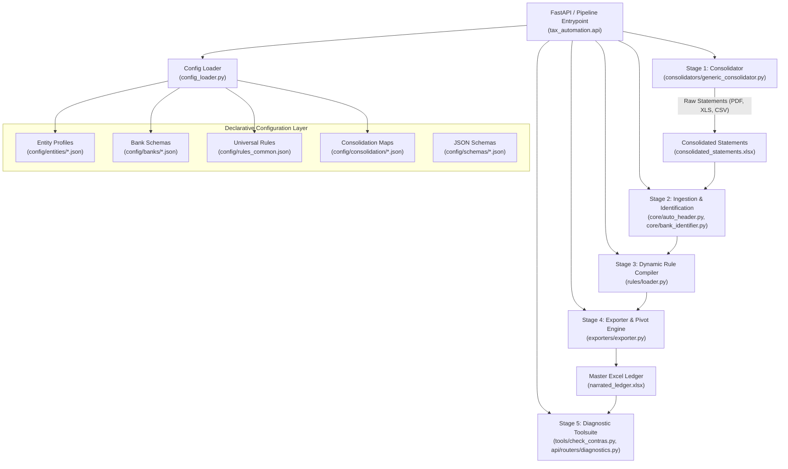
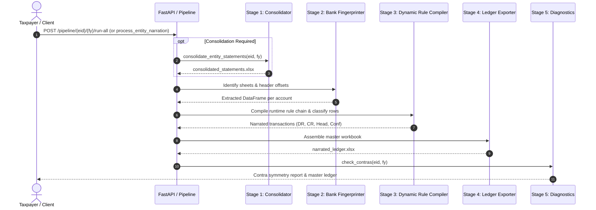
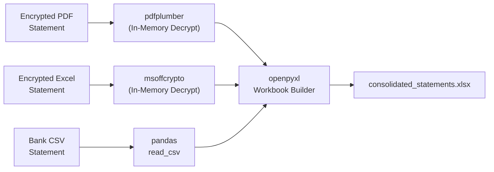
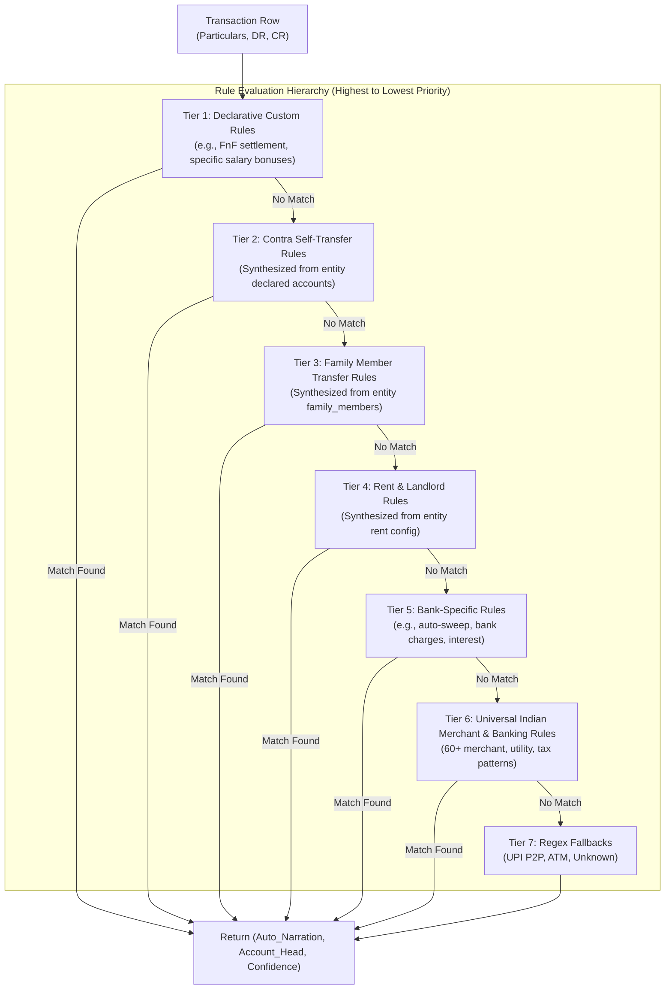
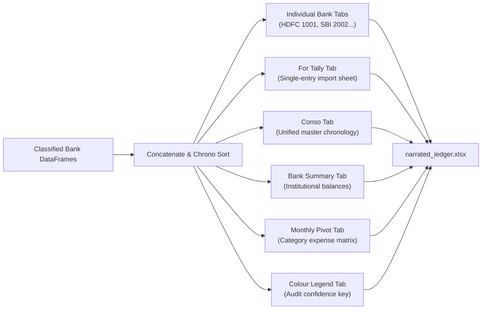
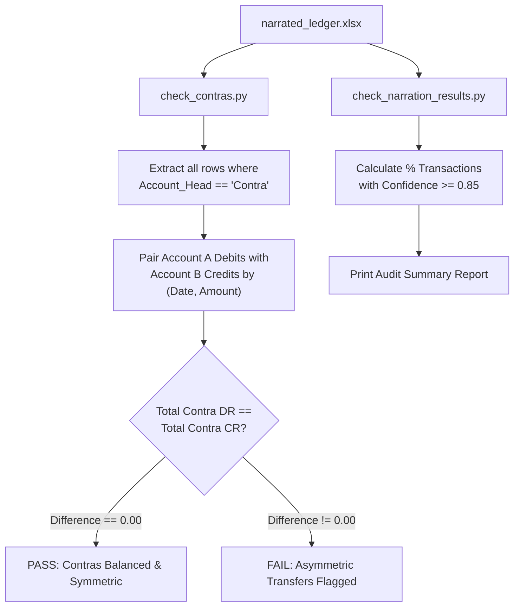

# Technical Architecture & Pipeline Documentation

This document provides a technical specification of the **Tax Automation System**, including its architectural design, internal components, data transformations, and input/output contracts at each stage of execution.

---

## Table of Contents

1. [System Architecture](#1-system-architecture)
2. [Stage-by-Stage Pipeline Lifecycle](#2-stage-by-stage-pipeline-lifecycle)
   - [Stage 1: Multi-Format Ingestion & Statement Consolidation](#stage-1-multi-format-ingestion--statement-consolidation)
   - [Stage 2: Bank Fingerprinting & Auto-Header Detection](#stage-2-bank-fingerprinting--auto-header-detection)
   - [Stage 3: Dynamic Rule Compilation & Transaction Classification](#stage-3-dynamic-rule-compilation--transaction-classification)
   - [Stage 4: Master Ledger Assembly & Multi-Sheet Excel Export](#stage-4-master-ledger-assembly--multi-sheet-excel-export)
   - [Stage 5: Validation Diagnostics & Contra Reconciliation](#stage-5-validation-diagnostics--contra-reconciliation)
3. [Data Specifications & Schemas](#3-data-specifications--schemas)
   - [Entity Profile Configuration Schema](#entity-profile-configuration-schema)
   - [Reusable Bank Schema Specification](#reusable-bank-schema-specification)
   - [Consolidation Map Specification](#consolidation-map-specification)
   - [Internal Normalized DataFrame Contract](#internal-normalized-dataframe-contract)
4. [Module Responsibility Matrix](#4-module-responsibility-matrix)

---

## 1. System Architecture

The Tax Automation System follows a decoupled, declarative, and stateless pipeline pattern. The core engine is packaged under `src/tax_automation/` with zero entity-specific hardcoding in source code. All taxpayer-specific rules and configurations reside in declarative JSON files.



---

## 2. Stage-by-Stage Pipeline Lifecycle



---

### Stage 1: Multi-Format Ingestion & Statement Consolidation

#### Purpose
Merges disparate statement files across multiple banks and accounts for an entity into a single, multi-sheet Excel file. It handles password decryption in memory without persisting credentials or unprotected files to disk.

#### Input
- **Source Statements**: Placed in `data/<entity_id>/<FY>/input/bank_statements/`.
  - Supported formats: `.xlsx`, `.xls` (BIFF8 OLE and modern), `.csv`, `.pdf` (tabular text and vector extracts).
- **Consolidation Mapping**: `config/consolidation/<entity_id>_<fy>.json`.
  - Maps source filename to destination sheet name and environment variable holding the decryption password.
- **Secrets**: Environment variables loaded from `.env` (e.g., `ENTITY_SBI_PASSWORD`).

#### Processing Mechanics
1. **Format Detection & Decryption**:
   - **Encrypted Excel (`.xls`, `.xlsx`)**: Decrypted in-memory via `msoffcrypto.OfficeFile(f).decrypt(io.BytesIO())` using the environment password.
   - **PDF Statements**: Decrypted in-memory with `pdfplumber.open(filepath, password=...)`. Table cells and column positions are extracted via bounding-box algorithms. Metadata rows (account holder, branch) from the first page are extracted to preserve bank header signals.
   - **CSV**: Ingested via `pandas.read_csv` with fallback encoding detection (`utf-8`, `latin1`).
2. **Sheet Aggregation**: Writes each ingested dataset into a dedicated worksheet named according to the consolidation map (e.g., `HDFC 1001`, `SBI 2002`).

#### Output
- **File**: `data/<entity_id>/<FY>/output/consolidated_statements.xlsx`
- **Structure**: An Excel workbook where each tab contains raw extracted statement rows for a single bank account.



---

### Stage 2: Bank Fingerprinting & Auto-Header Detection

#### Purpose
Identifies which bank schema applies to each worksheet in the consolidated workbook, and accurately locates the tabular data header row amidst variable bank header notes and disclaimer blocks.

#### Input
- Raw rows from each worksheet in `consolidated_statements.xlsx`.
- Runtime bank registry resolved via `config_loader.resolve_entity_bank_registry(entity_id)`.
- Reusable bank schemas from `config/banks/*.json`.

#### Processing Mechanics
1. **Header Row Discovery (`core/auto_header.py`)**:
   - Scans the first 40 rows of each sheet.
   - Evaluates keyword density against expected column headers (e.g., *Date*, *Particulars*, *Narration*, *Debit*, *Credit*, *Withdrawal*, *Deposit*, *Balance*, *Chq/Ref No*).
   - Returns zero-based `header_row_index`.
2. **Bank Identification (`core/bank_identifier.py`)**:
   - Searches metadata cells (rows before header) and header text for known institution signals:
     - *HDFC Bank*: `HDFC BANK`, `Statement of accounts`, `Withdrawal Amt`
     - *State Bank of India*: `State Bank of India`, `REGULAR SB CHQ`, `Drawing Power`
     - *Axis Bank*: `UTIB`, `AXIS`, `PARTICULARS`, `SRL NO`
     - *Kotak Mahindra*: `Cust. Reln. No.`, `Account Statement`, `KKBK`
     - *Federal Bank*: `Neo Banking`, `Jupiter`, `FDRL`
     - *Bank of India*: `BKID`, `Bank of India`, `Cr/Dr`
   - Computes weighted score against declared entity accounts. Resolves ambiguous matches using account number suffixes (e.g., `meta_signals_extra: ["1001"]`).

#### Output
- Matched `bank_key` (e.g., `hdfc`, `sbi`, `axis`).
- Standardized `pd.DataFrame` containing transaction records with mapped column names:
  - `col_date`, `col_particulars`, `col_dr`, `col_cr`, `col_balance`, `col_ref`, `col_value_date`.

---

### Stage 3: Dynamic Rule Compilation & Transaction Classification

#### Purpose
Translates transaction particular strings into standardized narrative labels and accounting heads, scoring each with a classification confidence rating between `0.00` and `1.00`.

#### Input
- Normalized row fields: `Particulars` (string), `DR` (float), `CR` (float).
- Entity configuration `config/entities/<entity_id>.json`.
- Universal rules `config/rules_common.json`.
- Bank base rules `src/tax_automation/rules/banks/<bank_key>_base.py`.

#### Rule Compilation & Priority Hierarchy

The dynamic compiler (`rules/loader.py`) synthesizes rules at runtime in strict precedence order:



#### Rule Synthesis Mechanics
- **Contra Rules**: For every declared account in `accounts`, the compiler generates bidirectional transfer matching rules using account IDs, bank keys, and last-4 digits (e.g., `TO HDFC 1001` labeled as `Contra - HDFC 1001`, head `Contra`).
- **Family Rules**: Every declared member in `family_members` generates regex rules tagged with their configured relationship head (e.g., `Family - Spouse`).
- **Rent Rules**: Landlord names, VPAs, and rent keywords compile into debit rules tagged `Rent Expense`.

#### Output
For each row, generates:
- `Auto_Narration`: Human-readable label (e.g., *Swiggy*, *Electricity Bill*, *Contra - SBI 2002*, *Salary*).
- `Account_Head`: Categorical accounting head (e.g., *Food & Dining*, *Utilities*, *Contra*, *Salary*).
- `Confidence`: Float from `0.00` to `1.00`.

---

### Stage 4: Master Ledger Assembly & Multi-Sheet Excel Export

#### Purpose
Consolidates narrated records from all individual bank accounts, builds accounting timelines, performs duplicate detection, aggregates balance summaries, and renders a formatted Excel workbook.

#### Input
- List of classified DataFrames across all processed bank accounts.
- Entity metadata (`display_name`, `pan`, `fy`).

#### Generated Worksheets Specification



1. **Individual Bank Tabs**: Formatted transaction tables preserving original institutional row orders with added `Auto_Narration`, `Account_Head`, and `Confidence` columns.
2. **For Tally**: Single-entry accounting format with normalized date formats (`YYYY-MM-DD`), debit amounts, credit amounts, and clean ledger heads suitable for direct Tally XML mapping.
3. **Conso (Master Ledger)**: Chronological union of all transactions across all accounts, sorted by transaction date.
4. **Bank Summary**: Financial institution ledger summary listing:
   - Account ID & Bank Name
   - Opening Balance (first recorded balance of the FY)
   - Total Deposits (CR Sum)
   - Total Withdrawals (DR Sum)
   - Closing Balance (last recorded balance of the FY)
   - Net Inflow / Outflow
5. **Monthly Pivot**: Two-dimensional cross-tabulation matrix:
   - Rows: Accounting Heads / Categories (e.g., *Food*, *Utilities*, *Travel*, *Investments*).
   - Columns: Financial Year Months (April through March).
   - Values: Sum of debit expenses.
6. **Colour Legend**: Visual audit key for Excel cells colored by confidence tiers:
   - **Green (`>= 0.85`)**: High confidence automated match.
   - **Yellow (`0.70 - 0.84`)**: Moderate confidence heuristic match.
   - **Light Red (`< 0.70`)**: Flagged for human review / manual verification.

#### Output
- **File**: `data/<entity_id>/<FY>/output/narrated_ledger.xlsx`

---

### Stage 5: Validation Diagnostics & Contra Reconciliation

#### Purpose
Executes mathematical reconciliation tests to verify that internal transfers match, detect potential duplicate charges, and ensure confidence scores meet audit thresholds.

#### Diagnostics Architecture



#### Verification Checks
1. **Contra Symmetry Verification (`tools/check_contras.py`)**:
   - Isolates all transactions classified as `Contra`.
   - Computes: `Total_Contra_DR - Total_Contra_CR`.
   - Verifies that every money transfer leaving Account A has an equivalent receiving credit in Account B within the same entity.
2. **Confidence Score Analysis (`tools/check_narration_results.py`)**:
   - Aggregates confidence ratings across all bank sheets.
   - Outputs match rate percentage and transaction count breakdown.

---

## 3. Data Specifications & Schemas

### Entity Profile Configuration Schema
Defined in `config/schemas/entity.json`:

```json
{
  "$schema": "http://json-schema.org/draft-07/schema#",
  "type": "object",
  "required": ["entity_id", "display_name", "accounts"],
  "properties": {
    "entity_id": { "type": "string", "pattern": "^[a-z0-9_]+$" },
    "display_name": { "type": "string" },
    "pan": { "type": "string" },
    "self_patterns": { "type": "array", "items": { "type": "string" } },
    "self_vpas": { "type": "array", "items": { "type": "string" } },
    "family_members": {
      "type": "array",
      "items": {
        "type": "object",
        "required": ["name", "patterns", "account_head"],
        "properties": {
          "name": { "type": "string" },
          "relationship": { "type": "string" },
          "patterns": { "type": "array", "items": { "type": "string" } },
          "account_head": { "type": "string" }
        }
      }
    },
    "rent": {
      "type": "object",
      "properties": {
        "landlords": { "type": "array", "items": { "type": "string" } },
        "vpas": { "type": "array", "items": { "type": "string" } },
        "keywords": { "type": "array", "items": { "type": "string" } }
      }
    },
    "custom_rules": {
      "type": "array",
      "items": {
        "type": "object",
        "required": ["label", "account_head"],
        "properties": {
          "label": { "type": "string" },
          "account_head": { "type": "string" },
          "pattern": { "type": "string" },
          "exact_amount": { "type": "number" },
          "direction": { "type": "string", "enum": ["DR", "CR", "dr", "cr", "ANY", "any", "both"] },
          "confidence": { "type": "number" }
        }
      }
    },
    "accounts": {
      "type": "array",
      "items": {
        "type": "object",
        "required": ["account_key", "bank", "account_id", "sheet_name"],
        "properties": {
          "account_key": { "type": "string" },
          "bank": { "type": "string" },
          "account_id": { "type": "string" },
          "sheet_name": { "type": "string" },
          "display_name": { "type": "string" },
          "meta_signals_extra": { "type": "array", "items": { "type": "string" } }
        }
      }
    }
  }
}
```

---

### Reusable Bank Schema Specification
Located in `config/banks/<bank_key>.json` (e.g., `hdfc.json`, `sbi.json`, `kotak.json`):

```json
{
  "display_name": "State Bank of India",
  "meta_signals": ["State Bank of India", "Current Account", "Drawing Power"],
  "header_signals": ["Txn Date", "Description", "Debit", "Credit", "Balance"],
  "col_date": ["Txn Date", "Date"],
  "col_particulars": ["Details", "Description"],
  "col_narration_h": "Narration",
  "col_dr": "Debit",
  "col_cr": "Credit",
  "col_balance": "Balance",
  "col_ref": ["Ref No./Cheque No.", "Ref No/Cheque No"],
  "col_value_date": "Value Date",
  "rules_module": "tax_automation.rules.banks.sbi_base"
}
```

---

### Consolidation Map Specification
Located in `config/consolidation/<entity_id>_<fy>.json`:

```json
{
  "entity": "demo_entity",
  "fy": "FY26",
  "output_filename": "All Bank Statements Demo FY26.xlsx",
  "files": [
    {
      "filename": "HDFC_Statement_1001.xls",
      "sheet_name": "HDFC 1001",
      "password_env_var": null
    },
    {
      "filename": "SBI_Statement_2002.xlsx",
      "sheet_name": "SBI 2002",
      "password_env_var": "ENTITY_SBI_PASSWORD"
    }
  ]
}
```

---

### Internal Normalized DataFrame Contract

During Stage 3 and Stage 4, all transaction records are represented with the following schema:

| Column | Type | Description |
| :--- | :--- | :--- |
| `TX_Date` | `datetime.date` / `str` | Normalized transaction booking date. |
| `Value_Date` | `datetime.date` / `str` | Value clearing date (optional). |
| `Particulars` | `str` | Raw transaction string from bank statement. |
| `Auto_Narration` | `str` | Classified human-readable label (e.g., *Swiggy*, *Contra - SBI 2002*). |
| `Account_Head` | `str` | Categorical ledger head (e.g., *Food & Dining*, *Contra*, *Salary*). |
| `Confidence` | `float` | Quality rating from `0.00` to `1.00`. |
| `DR` | `float` | Withdrawal amount (numeric float, `>= 0.0`). |
| `CR` | `float` | Deposit amount (numeric float, `>= 0.0`). |
| `Balance` | `float` / `str` | Account balance following the transaction. |
| `Ref` | `str` | Cheque, UTR, or transaction reference number. |
| `Bank_Key` | `str` | Identifier of the bank institution (e.g., `hdfc`). |
| `Bank_Display`| `str` | Human-readable bank name (e.g., `HDFC Bank Savings`). |
| `Account_ID` | `str` | Unique account designator (e.g., `HDFC 1001`). |

---

## 4. Module Responsibility Matrix

| Module | Location | Primary Responsibility | Key Functions / Classes |
| :--- | :--- | :--- | :--- |
| **API Service** | `src/tax_automation/api/` | FastAPI REST application, endpoints, routers, file streaming, and diagnostics. | `create_app()`, `lifespan`, routers |
| **Config Loader** | `src/tax_automation/config_loader.py` | Validates JSON profiles, bank schemas, and path resolution. | `resolve_entity_bank_registry()`, `resolve_input_dir()`, `resolve_output_dir()` |
| **Auto Header** | `src/tax_automation/core/auto_header.py` | Detects variable tabular header row index in raw sheets. | `find_header_row()` |
| **Bank Identifier** | `src/tax_automation/core/bank_identifier.py` | Fingerprints bank institution and maps account identity. | `identify_bank()` |
| **Merchant Parser** | `src/tax_automation/core/merchants.py` | UPI regex and commercial merchant extraction. | `detect_merchant()`, `parse_upi_string()` |
| **Consolidator** | `src/tax_automation/consolidators/generic_consolidator.py` | Decrypts and merges multi-format files into single workbook. | `consolidate_entity_statements()`, `decrypt_excel()` |
| **Rule Compiler** | `src/tax_automation/rules/loader.py` | Dynamically compiles contra, family, rent, and custom rule chains. | `build_rule_chain()` |
| **Narration Pipeline** | `src/tax_automation/pipeline/narration.py` | Drives row classification and combines per-bank DataFrames. | `process_entity_narration()`, `get_col_value()` |
| **Consolidation Pipeline** | `src/tax_automation/pipeline/consolidation.py` | Orchestrates Stage 1 execution from high-level pipeline. | `consolidate_entity()` |
| **Exporter** | `src/tax_automation/exporters/exporter.py` | Formats Excel workbooks, Tally sheets, summaries, and pivots. | `write_for_tally()`, `write_conso()`, `write_bank_summary()`, `write_monthly_pivot()` |
| **Diagnostics** | `src/tax_automation/tools/check_contras.py` | Reconciles inter-account contra transfers across accounts. | `verify_contras()` |
