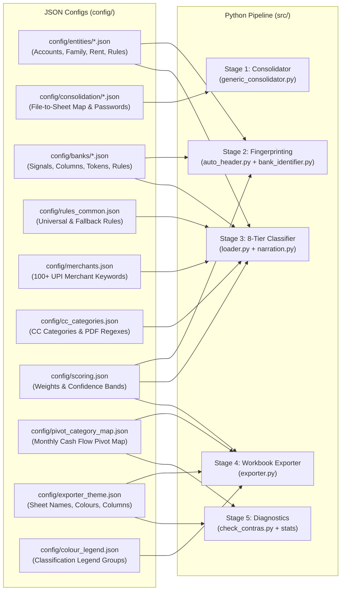
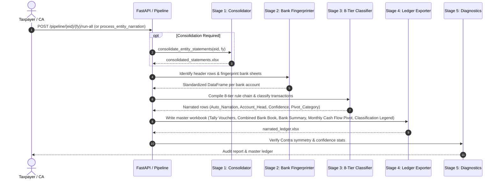
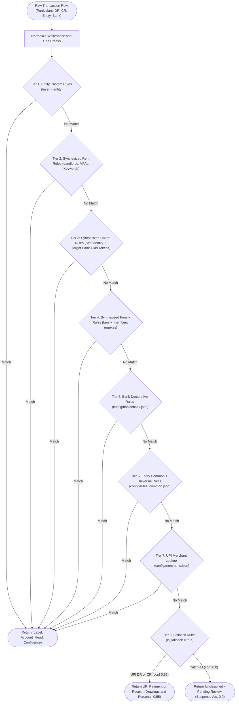

# Technical Architecture & Pipeline Documentation

This document provides the complete technical specification of the **Tax Automation System (`v2.0`)**, including its 100% config-driven architecture, internal pipeline stages, 8-tier dynamic rule compilation, Indian Taxation & Tally nomenclature, and data contracts.

---

## Table of Contents

1. [System Architecture & Config Dependency Graph](#1-system-architecture--config-dependency-graph)
2. [Stage-by-Stage Pipeline Lifecycle](#2-stage-by-stage-pipeline-lifecycle)
   - [Stage 1: Multi-Format Ingestion & Statement Consolidation](#stage-1-multi-format-ingestion--statement-consolidation)
   - [Stage 2: Bank Fingerprinting & Auto-Header Detection](#stage-2-bank-fingerprinting--auto-header-detection)
   - [Stage 3: 8-Tier Dynamic Rule Compilation & Transaction Classification](#stage-3-8-tier-dynamic-rule-compilation--transaction-classification)
   - [Stage 4: Master Ledger Assembly & Multi-Sheet Excel Export](#stage-4-master-ledger-assembly--multi-sheet-excel-export)
   - [Stage 5: Validation Diagnostics & Human Review Loop](#stage-5-validation-diagnostics--human-review-loop)
3. [Declarative Configuration Schemas](#3-declarative-configuration-schemas)
   - [Entity Profile Configuration Schema (`config/entities/*.json`)](#entity-profile-configuration-schema-configentitiesjson)
   - [Reusable Bank Schema Specification (`config/banks/*.json`)](#reusable-bank-schema-specification-configbanksjson)
   - [Consolidation Map Specification (`config/consolidation/*.json`)](#consolidation-map-specification-configconsolidationjson)
   - [Internal Normalized DataFrame Contract](#internal-normalized-dataframe-contract)
4. [Module Responsibility Matrix](#4-module-responsibility-matrix)

---

## 1. System Architecture & Config Dependency Graph

The Tax Automation System follows a decoupled, declarative, and stateless pipeline pattern. Every rule, bank schema, alias token, scoring threshold, pivot category, and worksheet layout resides in JSON files under `config/` and is loaded via `src/tax_automation/config_loader.py`.



---

## 2. Stage-by-Stage Pipeline Lifecycle



---

### Stage 1: Multi-Format Ingestion & Statement Consolidation

- **Module**: `src/tax_automation/consolidators/generic_consolidator.py`
- **Input**: Raw files in `data/<entity_id>/<FY>/input/bank_statements/` + mapping in `config/consolidation/<entity_id>_<fy>.json`.
- **Mechanics**:
  1. **Encrypted Excel (`.xls`, `.xlsx`)**: Decrypted in-memory via `msoffcrypto.OfficeFile(f).decrypt(io.BytesIO())` using the environment variable specified in `password_env_var`.
  2. **PDF Statements (`.pdf`)**: Decrypted in-memory with `pdfplumber.open(filepath, password=...)`, extracting first-page metadata lines followed by tabular rows.
  3. **CSV & Legacy BIFF8/OLE Excel**: Automatically detects OLE headers (`\xd0\xcf\x11\xe0`) and routes to `xlrd` or `openpyxl` accordingly.
- **Output**: `data/<entity_id>/<FY>/output/consolidated_statements.xlsx` (one worksheet per bank account).

---

### Stage 2: Bank Fingerprinting & Auto-Header Detection

- **Modules**: `src/tax_automation/core/auto_header.py` and `src/tax_automation/core/bank_identifier.py`
- **Configs**: `config/header_keywords.json`, `config/scoring.json`, and `config/banks/*.json`
- **Mechanics**:
  1. **Header Row Discovery (`find_header_row`)**: Scans the first `max_scan_rows` (40) rows of a worksheet for the first row containing at least one date keyword and one amount keyword from `config/header_keywords.json`.
  2. **Weighted Bank Scoring (`identify_bank`)**: Scores each account in the entity's merged bank registry using weights from `config/scoring.json`:
     - **With preamble (`header_row_idx > 0`)**: `0.60 * meta_score + 0.40 * header_score` (plus a `0.30` sheet-name match bonus).
     - **Without preamble (`header_row_idx == 0`)**: `1.00 * header_score`.
     - Accepts the highest-scoring account if `score >= acceptance_threshold` (`0.55`).

---

### Stage 3: 8-Tier Dynamic Rule Compilation & Transaction Classification

- **Modules**: `src/tax_automation/rules/loader.py`, `src/tax_automation/rules/common_base.py`, `src/tax_automation/pipeline/narration.py`
- **Configs**: `config/entities/*.json`, `config/banks/*.json`, `config/rules_common.json`, `config/merchants.json`, `config/scoring.json`



#### Declarative Rule Compiler (`_compile_declarative_rule`)
Every rule in `config/rules_common.json`, `config/banks/*.json`, and `config/entities/*.json` supports:
- `label`: Standardized narration label
- `account_head`: Indian Taxation / Tally ledger head
- `pattern`: Case-insensitive regex (any match)
- `patterns_all`: Array of regexes (all must match)
- `exclude_pattern`: Regex that disqualifies the rule if matched
- `direction`: `"DR"`, `"CR"`, or `"ANY"`
- `exact_amount`, `exact_dr`, `exact_cr`, `min_dr`, `max_dr`, `min_cr`, `max_cr`, `dr_in`, `cr_in`, `exclude_exact_dr`, `exclude_exact_cr`: Numeric filters
- `confidence`: Float (`0.00–1.00`)
- `is_fallback`: Boolean (`true` places the rule in `FALLBACK_RULES`, evaluated after UPI merchant detection)

---

### Stage 4: Master Ledger Assembly & Multi-Sheet Excel Export

- **Module**: `src/tax_automation/exporters/exporter.py`
- **Configs**: `config/exporter_theme.json`, `config/pivot_category_map.json`, `config/colour_legend.json`, `config/scoring.json`
- **Generated Worksheets**:
  1. **Per-Bank Tabs** (`HDFC 5413`, `SBI 1227`, etc.): Individual bank ledgers with a top horizontal colour legend and 3-tier confidence cell colouring.
  2. **`Tally Vouchers`**: Consolidated, chronologically sorted single-entry ledger across all accounts with `Review Remarks` and `Pivot Category` columns.
  3. **`Combined Bank Book`**: Unified running ledger across all banks with top `SUBTOTAL(9, ...)` formulas.
  4. **`Bank Summary`**: Dynamic `SUMIFS` narration summary, Opening & Closing Balance reconciliation per account, and `COUNTIF`/`COUNTIFS` Confidence Band distribution.
  5. **`Monthly Cash Flow Pivot`**: Interactive month-by-month Cash Flow matrix with **Bank Filter Toggles** (`TRUE`/`FALSE` dropdowns in Row 4) separating:
     - **Payments / Expenses (Bank + CC)** — including a dedicated **`Suspense / Pending Human Review`** row
     - **Receipts / Income (Bank)** — including a dedicated **`Suspense / Pending Human Review`** row
     - **Self-Transfers (Contra)**
  6. **`Classification Legend`**: Complete visual audit guide built from `config/colour_legend.json`.

---

### Stage 5: Validation Diagnostics & Human Review Loop

- **Modules**: `src/tax_automation/tools/check_contras.py`, `src/tax_automation/tools/parse_narration_stats.py`, `src/tax_automation/tools/parse_all_stats.py`, `src/tax_automation/api/routers/diagnostics.py`
- **Checks**:
  1. **Contra Symmetry (`check_contras.py`)**: Scans all bank sheets for labels starting with `contra_label_prefix` (`"Contra -"`) and verifies `abs(Total_DR - Total_CR) < 1.00`.
  2. **Confidence Distribution (`parse_narration_stats.py`)**: Computes High (`>= 0.85`), Medium (`0.60–0.84`), and Low (`< 0.60`) classification counts and percentages.
  3. **Human Review (`Unclassified - Pending Review`)**: Unclear transactions land in `Suspense A/c (Pending Review)` and aggregate on the `Suspense / Pending Human Review` row of the Monthly Cash Flow Pivot so a human reviewer or CA can either add a declarative JSON rule or note a clarification in the `Review Remarks` column.

---

## 3. Declarative Configuration Schemas

### Entity Profile Configuration Schema (`config/entities/*.json`)
Validated against `config/schemas/entity.json`:
- `entity_id`, `display_name`, `pan`
- `self_patterns`, `self_vpas`
- `contra_confidence`, `self_transfer_confidence`, `family_transfer_confidence`, `rent_confidence` (optional per-entity confidence overrides)
- `family_members[]`: `{ "name", "relationship", "account_head", "patterns" }`
- `rent`: `{ "landlords", "vpas", "keywords" }`
- `custom_rules[]`: Declarative rules with `"layer": "entity"` (Tier 1) or `"layer": "common"` (Tier 6)
- `pivot_overrides`: Optional entity-specific overrides for `narration_to_payment_category`, `head_to_payment_category`, `narration_to_receipt_category`, `head_to_receipt_category`
- `accounts[]`: `{ "account_key", "bank", "account_id", "sheet_name", "display_name", "meta_signals_extra", "exclude_patterns" }`

### Reusable Bank Schema Specification (`config/banks/*.json`)
```json
{
  "bank_key": "sbi",
  "display_name": "State Bank of India",
  "rules_module": null,
  "alias_tokens": ["\\bSBI\\b", "\\bSBIN\\b", "STATE\\s*BANK\\s*OF\\s*INDIA", "STATE\\s*BANK"],
  "rules": [
    {
      "label": "PPF Deposit",
      "account_head": "Deduction u/s 80C - PPF",
      "pattern": "SBIYA.*PPF|INB.*PPF|\\bPPF\\b",
      "direction": "DR",
      "confidence": 0.88
    }
  ],
  "meta_signals": ["State Bank of India", "Drawing Power", "REGULAR SB CHQ", "SBIN"],
  "header_signals": ["Txn Date", "Ref No./Cheque No.", "Debit", "Credit"],
  "col_date": ["Txn Date", "Date"],
  "col_particulars": ["Details", "Description"],
  "col_narration_h": "Narration",
  "col_dr": "Debit",
  "col_cr": "Credit",
  "col_balance": "Balance",
  "col_ref": ["Ref No./Cheque No.", "Ref No/Cheque No"],
  "col_value_date": "Value Date"
}
```

### Consolidation Map Specification (`config/consolidation/*.json`)
```json
{
  "entity": "aayush",
  "fy": "FY26",
  "files": [
    {
      "filename": "HDFC_Statement_5413.xls",
      "sheet_name": "HDFC 5413",
      "password_env_var": null
    },
    {
      "filename": "SBI_Statement_1227.xlsx",
      "sheet_name": "SBI 1227",
      "password_env_var": "AAYUSH_SBI_PASSWORD"
    }
  ]
}
```

### Internal Normalized DataFrame Contract

| Column | Type | Description |
| :--- | :--- | :--- |
| `TX_Date` | `datetime.date` / `str` | Transaction booking date |
| `Value_Date` | `datetime.date` / `str` | Value clearing date |
| `Particulars` | `str` | Raw transaction narration from statement |
| `Auto_Narration` | `str` | Classified narration label (e.g., `Salary`, `Contra - HDFC Bank`, `Unclassified - Pending Review`) |
| `Account_Head` | `str` | Standardized Indian Tax / Tally ledger head (e.g., `Income from Salary`, `Suspense A/c (Pending Review)`) |
| `Confidence` | `float` | Rule confidence score (`0.00–1.00`) |
| `DR` | `float` | Debit / withdrawal amount (`>= 0.0`) |
| `CR` | `float` | Credit / deposit amount (`>= 0.0`) |
| `Balance` | `float` / `str` | Running balance after transaction |
| `Ref` | `str` | Cheque / UTR / reference number |
| `Bank_Key` | `str` | Bank key (`hdfc`, `sbi`, `kotak`, etc.) |
| `Bank_Display` | `str` | Human-readable bank name |
| `Account_ID` | `str` | Account identifier (`HDFC 5413`, `SBI 1227`) |
| `Pivot_Category` | `str` | Assigned Monthly Cash Flow Pivot category |
| `Duplicate` | `str` | `"⚠ Possible Duplicate"` or `""` |

---

## 4. Module Responsibility Matrix

| Module | Location | Primary Responsibility |
| :--- | :--- | :--- |
| **API Service** | `src/tax_automation/api/` | FastAPI REST service (`/entities`, `/files`, `/pipeline`, `/diagnostics`). |
| **Config Loader** | `src/tax_automation/config_loader.py` | Loads all 10 JSON config families, merges entity bank registries, resolves paths & `.env` secrets. |
| **Auto Header** | `src/tax_automation/core/auto_header.py` | Detects tabular header row index using `config/header_keywords.json`. |
| **Bank Identifier** | `src/tax_automation/core/bank_identifier.py` | Scores bank worksheets using weights and thresholds from `config/scoring.json`. |
| **Merchant Parser** | `src/tax_automation/core/merchants.py` | Matches UPI strings against `config/merchants.json`. |
| **CC Parser** | `src/tax_automation/core/parse_cc.py` | Parses Credit Card PDF statements using regexes and categories from `config/cc_categories.json`. |
| **Consolidator** | `src/tax_automation/consolidators/generic_consolidator.py` | Decrypts in-memory and merges `.xlsx`, `.xls`, `.csv`, and `.pdf` statements. |
| **Rule Compiler** | `src/tax_automation/rules/loader.py` | Compiles the 8-tier rule chain (`bank_rules`, `main_common_rules`, `fallback_rules`). |
| **Narration Pipeline** | `src/tax_automation/pipeline/narration.py` | Orchestrates header detection, bank fingerprinting, classification, pivot mapping, and export. |
| **Exporter** | `src/tax_automation/exporters/exporter.py` | Writes colour-coded bank tabs, `Tally Vouchers`, `Combined Bank Book`, `Bank Summary`, `Monthly Cash Flow Pivot`, and `Classification Legend`. |
| **Diagnostics** | `src/tax_automation/tools/` | Verifies Contra balance symmetry (`check_contras.py`) and confidence stats (`parse_narration_stats.py`). |
